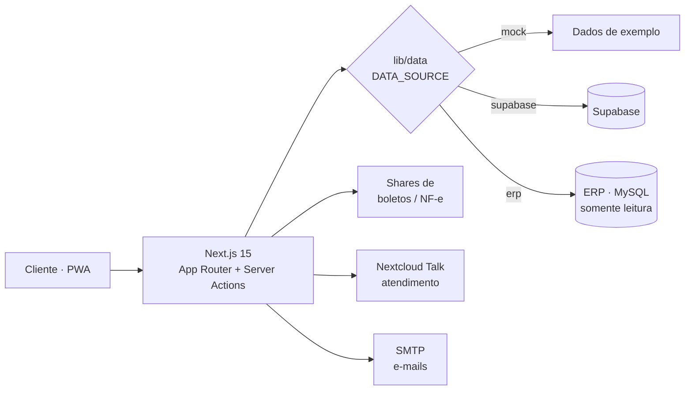

# Portal Área do Cliente

> Portal **B2B de autoatendimento** para clientes de uma indústria têxtil — construído em **Next.js**. Os clientes acessam a 2ª via de boletos, notas fiscais, abrem atendimento e solicitam prorrogações, tudo em um app instalável (PWA).


> **Esta é uma vitrine.** O código de produção, as credenciais e qualquer dado de cliente ficam em repositório privado. Aqui mostramos apenas a arquitetura e as decisões de engenharia.

---

## O que o portal resolve

Antes, cada cliente que precisava de uma 2ª via de boleto ou de uma nota fiscal ligava ou mandava e‑mail para o financeiro. O portal transformou isso em autoatendimento:

- **Boletos** — 2ª via em PDF, com validação do código de barras e aviso de títulos já baixados.
- **Notas fiscais** — DANFE gerada a partir do XML, pronta para download.
- **Prorrogação** — o cliente solicita novo vencimento (individual ou em lote) e o financeiro aprova pelo painel.
- **Atendimento (SAC)** — chat em tempo real cliente ↔ equipe, integrado ao Nextcloud Talk.
- **Catálogo** — vitrine de produtos para o cliente consultar.

E, do lado interno, um **painel administrativo**: gestão de contas, envio de boletos, representantes, configurações e um **dashboard de uso** (quantos clientes temos, quantos usam o portal e com que frequência).

---

## Destaques de engenharia

**Camada de dados plugável.** Toda a UI conversa com um único contrato (`lib/data`), e a origem dos dados é escolhida por uma variável de ambiente:

```
DATA_SOURCE = mock | supabase | erp
```

O mesmo código roda com dados de exemplo (para desenvolvimento e para a demo pública), com Supabase, ou lendo direto do ERP — **sem tocar em um componente sequer**. Trocar de backend é trocar uma linha.

**Provider de ERP somente‑leitura.** O acesso ao ERP é deliberadamente restrito a `SELECT`: o portal nunca escreve no sistema financeiro. Isso é uma regra de segurança do projeto, não um detalhe de implementação.

**Next.js 15 com Server Actions.** Sem cliente de API pesado no navegador: as mutações são Server Actions, a renderização é no servidor (App Router), e o bundle que chega ao cliente é enxuto.

**PWA de verdade.** Manifest, service worker e shell offline — o cliente instala o portal como app no celular e abre direto no boleto.

**Dois destinos de deploy.** Uma build pública de demonstração (dados mock) e a build interna que alcança o ERP, a partir do mesmo código‑fonte.

---

## Arquitetura



---

## Stack

| Camada | Tecnologia |
| --- | --- |
| Framework | Next.js 15 (App Router), React, TypeScript |
| Interação | Server Actions, Server Components |
| Dados | Contrato único com 3 providers: mock · Supabase · ERP (MySQL, read-only) |
| Documentos | Geração de DANFE a partir de XML; 2ª via de boleto em PDF |
| Atendimento | Integração com Nextcloud Talk |
| App | PWA (manifest + service worker), tema claro/escuro |
| Entrega | Serviço Windows (`next start`) para a build interna · Vercel para a demo pública |

---

## Estrutura (resumo)

```
app/            # rotas (área do cliente + painel admin) via App Router
components/     # UI reutilizável (boletos, atendimento, dashboard, prorrogação…)
lib/            # contrato de dados, providers, sessão, geração de documentos
public/         # ícones, manifest, service worker
```

---

## Status

Em produção, usado diariamente pelos clientes. Código‑fonte, variáveis de ambiente e dados são **privados** — este repositório existe apenas para mostrar como o portal foi construído.

<sub>Feito pela equipe de TI da Betel Sport.</sub>
